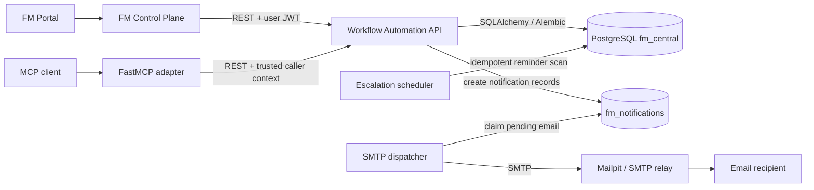
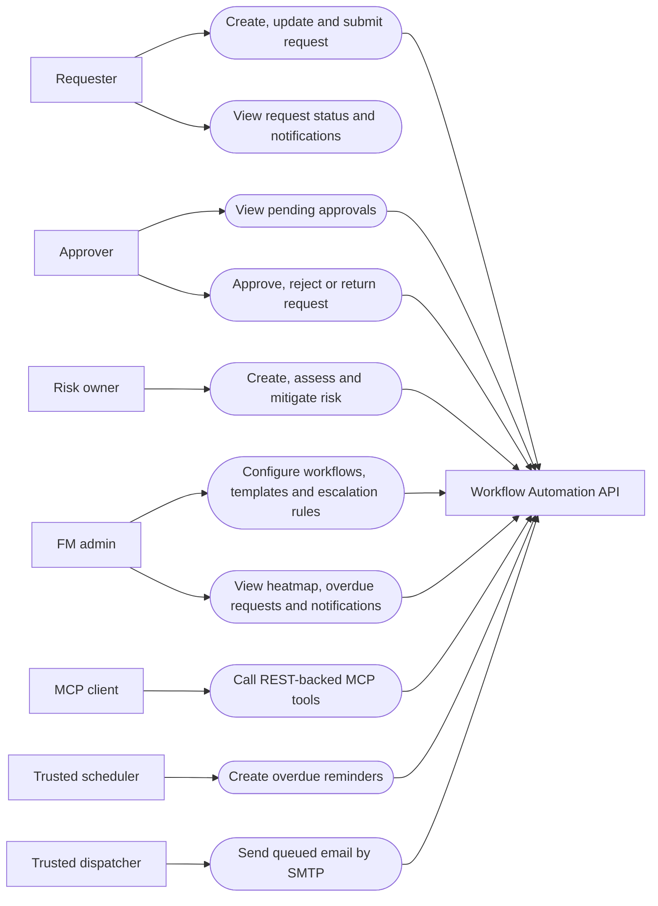

# FM MCP Server

`fm-mcp` là repository của module Workflow Automation (EPIC 3). Module có một
FastAPI API sở hữu dữ liệu workflow trong `fm_central` và một FastMCP adapter
gọi API đó qua REST. FM Control Plane chỉ điều phối giữa các module.

Xem thiết kế chi tiết tại [docs/architecture.md](docs/architecture.md).

## Cài đặt

```bash
cp .env.example .env
pip install -e .
```

Workflow Automation API dùng `DATABASE_URL` để kết nối `fm_central`. MCP adapter
dùng `FM_WORKFLOW_API_URL`; nó không nhận database credentials.

`fm-mcp` có Alembic history riêng với version table `alembic_version_fm_mcp`.
Migration của module chỉ thao tác các bảng EPIC 3 mà module sở hữu.

## Architecture overview



Control Plane và MCP không truy cập database trực tiếp. Workflow Automation API
là boundary duy nhất thực thi RBAC, transaction, audit và state machine.

## Use cases



## Chạy server

```bash
fm-mcp
```

## Test

Unit test mock HTTP client của API khi test MCP adapter. Integration test chạy
với PostgreSQL test database riêng và chỉ ở đó mới chạy migration của module.

## Migration

Các migration của EPIC 3 nằm trong `alembic/versions` và dùng version table
`alembic_version_fm_mcp`. Chỉ chạy chúng với database development/test riêng:

```bash
FM_ENV=test DATABASE_URL=postgresql+asyncpg://... ./scripts/migrate.sh
```

## Docker Compose development

```bash
docker compose up -d postgres
docker compose run --rm migrate
docker compose up -d api
docker compose run --rm mcp
```

`mcp` uses stdio. Trong local development, nó chuyển `FM_MCP_DEV_USER_ID` thành
identity header cho API; không dùng cấu hình này ở production.
## Extended services

EPIC 3 owns its Workflow Automation tables in `fm_central`. The FastAPI service
owns database access; FastMCP only calls the API over REST.

### Local run

```bash
docker compose up -d postgres
docker compose run --rm migrate
docker compose up -d api
```

### Portal thử nghiệm request

Trong tenant `rmit_fm`, người có quyền quản lý tenant có thể mở **Yêu cầu FM**
để chạy luồng tạo bản nháp, gửi duyệt và xem lịch sử qua các tool
`list_workflows`, `list_requests`, `create_request`, `submit_request`,
`get_request` và `get_request_history` trên FM MCP đã đăng ký. Đây là luồng
dev/demo: thao tác dùng danh tính đã cấu hình tại FM MCP server, không phải
định danh người đăng nhập Portal. Không bật luồng này cho nghiệp vụ production
trước khi hoàn thành truyền/ủy quyền danh tính người dùng.

Chạy test tool adapter và luồng request bằng:

```bash
pytest tests/unit -q
```

The API is available at `http://localhost:8000`, with OpenAPI documentation at
`http://localhost:8000/docs`. Development authentication uses
`X-Authenticated-User-Id` and `X-Authenticated-Roles`; production requires a
validated JWT from the Control Plane.

### Services

- Workflow requests: draft, update, submit, close and immutable status history.
- Approvals: sequential `any`/`all` processing, database row locking and
  `Idempotency-Key` support. Person-level approvers come from
  `workflow_step.conditions.approver_ids`; otherwise the Control Plane role in
  the authenticated identity is used.
- Risk register: create/update, assessment, latest assessment and heatmap.
  The current score default is likelihood × impact on the existing 1–5 schema;
  confirm the RMIT matrix before production policy is enabled.
- Notifications: creating an FM request adds an email to the transactional
  outbox; the Compose dispatcher continuously delivers it through SMTP.
  Configure `FM_REQUEST_NOTIFICATION_EMAIL` as the recipient (Mailpit captures
  it in local development). SMTP delivery is asynchronous and retries failures.
- Escalation: call the trusted scheduler worker, never a public manual endpoint:

```bash
docker compose --profile tools run --rm scheduler
```

The database unique constraint makes repeated scans idempotent for an approval
step, escalation rule and scheduled time.

### Email and Mailpit

Email notifications are stored first in `fm_notifications`, then dispatched by
a trusted worker with row locking. Set `FM_SMTP_*` in deployment. Local Compose
provides Mailpit at `http://localhost:8025` and an SMTP relay on port `1025`:

```bash
docker compose up -d mailpit
docker compose --profile tools run --rm dispatcher
```

Create an `email` notification template for an event code, then queue an email
notification through `POST /api/v1/notifications`. Template placeholders are
limited to `{{payload_key}}` or dotted payload fields and do not execute code.

Xem [docs/architecture.md](docs/architecture.md) để có mô tả boundary, database
ownership, security và cấu hình runtime đầy đủ.

Người mới nên đọc [docs/onboarding.md](docs/onboarding.md): tài liệu này có
code map, sequence diagram cho request/approval/email và giải thích function
chính theo từng module.
