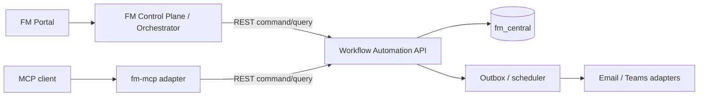

# Kiến trúc FM Workflow Automation (EPIC 3)

## Ranh giới hệ thống

Control Plane là lớp orchestration chung của platform FM. EPIC 3 là một module
độc lập, sở hữu lifecycle workflow, request, approval, risk, notification và
escalation của chính nó. Module được đặt trong repository `fm-mcp` và có hai
runtime độc lập dùng chung domain code:

1. **Workflow Automation API**: FastAPI service sở hữu bảng EPIC 3 trong
   PostgreSQL `fm_central`, REST API, RBAC, transaction, audit và scheduler.
2. **FM MCP adapter**: FastMCP service không truy cập database trực tiếp; nó
   gọi Workflow Automation API qua REST với caller context đã xác thực.



Control Plane không ghi trực tiếp vào bảng EPIC 3. Nó gọi API của module như
một client có quyền hạn phù hợp. Điều này giữ ownership rõ ràng khi platform có
nhiều module khác.

## Ownership database và migration

Workflow Automation API sở hữu các bảng có prefix `fm_` được chỉ định cho EPIC
3: workflow definitions/steps, requests/history, approvals, risks/assessments,
notifications/templates, escalation/reminders, attachments và audit logs.

Các bảng nằm trong PostgreSQL `fm_central`, nhưng chỉ migration package của
module này được tạo hoặc thay đổi chúng. Không tạo database thứ hai cho MCP.

Mỗi module có Alembic history riêng dù cùng dùng physical database `fm_central`.
`fm-mcp` dùng `alembic_version_fm_mcp`; Control Plane và các module khác phải
dùng version table riêng của chúng. Vì vậy migration đầu tiên của EPIC 3 là root
revision của module (`down_revision = None`) và không cần phụ thuộc migration
head của Control Plane.

Migration EPIC 3 chỉ tạo hoặc thay đổi bảng do module sở hữu. Release pipeline
phải chạy `alembic -c alembic.ini upgrade head` của từng module theo thứ tự đã
được platform điều phối; không dùng migration của module này để thay đổi bảng
Control Plane.

## Tổ chức repository đề xuất

```text
src/fm_mcp/
  api/
    main.py                 # FastAPI app factory
    dependencies.py         # DB session, current user, RBAC
    routers/                # /api/v1/workflows, requests, approvals, risks...
  domain/
    models/                 # SQLAlchemy 2.x models EPIC 3
    schemas/                # Pydantic v2 Create/Update/Read/List
    repositories/           # Query persistence boundary
    services/               # Transactional business rules
  infrastructure/
    database.py             # async engine, session, Base
    outbox.py               # reliable event delivery if platform provides it
    notifications.py        # adapters, never coupled to models
    scheduler.py            # overdue reminders/escalation runner
  mcp/
    server.py               # FastMCP server
    tools/                  # thin REST adapter tools
  core/
    config.py
    security.py
    exceptions.py
    logging.py
alembic/
  versions/                 # EPIC 3 migrations only
tests/
  unit/
  integration/
```

`api` và `mcp` là hai entry point deploy độc lập. MCP process gọi API qua
HTTP ngay cả khi cùng repository; nó không import repository hoặc mở DB session.

## API và MCP responsibilities

| Capability | Workflow Automation API | MCP adapter |
|---|---|---|
| PostgreSQL, Alembic, SQLAlchemy | Owns | Never accesses |
| Request and approval state machine | Owns | Calls API |
| Current user and RBAC | Validates | Forwards trusted caller token |
| Idempotency, locking, audit | Enforces in DB transaction | Forwards idempotency/correlation headers |
| Notifications and reminders | Creates records, scheduler delivers | Reads safe status only |
| Control Plane integration | Serves REST contract | Uses the same REST contract |

API exposes the EPIC 3 REST endpoints: workflow list, requests and history,
pending/approve/reject approvals, risks/assessments and heatmap, notifications,
and overdue requests. MCP tools map one-to-one to this contract. Manual
escalation is an internal scheduler responsibility, not an unrestricted MCP tool.

## Identity và security

Portal, Control Plane và MCP phải pass user/service JWT tới Workflow Automation
API. API validate issuer/audience và resolve caller qua identity/organisational
data có sẵn; nó không tin `actor_id`, `approver_id`, `requester_id` trong
payload.

API dùng transaction nguyên tử và row locking cho submit, approve, reject,
close, reminder generation và audit. API sở hữu xử lý `Idempotency-Key` cho
mọi mutable operation. MCP không log access token và chỉ trả normalized error.

## Runtime configuration

| Variable | Used by | Purpose |
|---|---|---|
| `DATABASE_URL` | Workflow Automation API | Async PostgreSQL URL for `fm_central`. |
| `FM_WORKFLOW_API_URL` | MCP adapter | Base URL of Workflow Automation API. |
| `FM_API_TIMEOUT` | MCP adapter | HTTP timeout in seconds. |
| `FM_ENV` | Both | Runtime environment. |
| `FM_WORKFLOW_API_AUDIENCE` | Both | Expected API audience for JWT/OAuth. |

Database credentials exist only in API deployment. MCP deployment receives no
`DATABASE_URL`.

## Implementation sequence

1. Inspect/agree platform identity contract, `fm_central` schema baseline and
   migration ownership convention.
2. Add FastAPI app, async SQLAlchemy session and EPIC 3 models.
3. Write five reviewed migrations: workflow/request; approval; risk;
   notification/escalation; attachments/audit.
4. Implement schemas, repositories, transactional services and REST routers.
5. Implement MCP REST adapter tools against the completed API contract.
6. Test migrations on isolated database, service concurrency and MCP/API
   integration. Do not run migrations against shared or production database.
