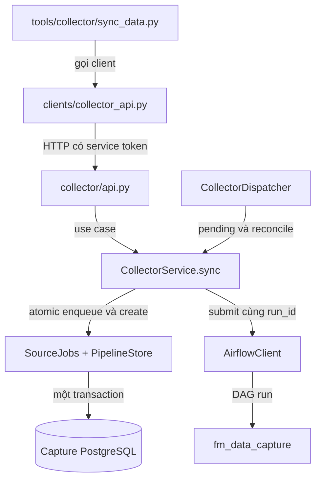

# Collector Orchestration Service

Service đứng sau nhóm MCP collector, chạy bằng `fm-collector-api` trên cổng nội bộ
8021. Không sinh mã DAG từ chat và không import `titan_runtime`, dlt hoặc dbt.

## Đọc code

| Module | Trách nhiệm |
|---|---|
| `tools/collector/` | Sync, test, status, history, cancel, retry |
| `clients/collector_api.py` | MCP gọi service, không gọi Capture API của CP |
| `collector/api.py` | Contract API operator và API worker riêng |
| `collector/service.py` | Use cases, atomic enqueue/outbox và replay Bronze |
| `collector/source_jobs.py` | Repository source BMS/SPO dùng chung implementation |
| `collector/repository.py` | Pipeline/attempt/event, fencing và public redaction |
| `collector/dispatcher.py` | Dispatch pending và đối soát DAG |
| `collector/airflow_client.py` | Adapter Airflow REST với stable run ID |
| `collector/definition.py` | Danh sách bước và retry policy duy nhất |
| `collector/airflow_tasks.py` | Airflow gọi worker, đợi status và kiểm tra heartbeat |
| `orchestration/airflow/dags/fm_data_capture.py` | Template DAG mỏng |

## API và token

`/internal/tenants/{org}` dùng `FM_COLLECTOR_SERVICE_TOKEN`: health,
`connections/{id}/test`, `/sync`, `/sync/retry`, `/capture/status`, `/capture/jobs`,
`/capture/cancel`; `pipelines` hỗ trợ list/detail/events/cancel/retry.
Tool chỉ nhận identifier/request_key, không nhận source config tùy ý.

`/internal/worker/{org}/runs/{id}` dùng `CAPTURE_RUNNER_TOKEN` riêng:
private context, begin, pulse, finish, output, complete, cancel.
Operator token không đọc API worker; cả hai nhóm kiểm tra tenant binding.

Service đọc snapshot từ CP bằng `FM_COLLECTOR_CONTEXT_TOKEN` qua endpoint chỉ đọc
`/api/internal/collector-context/{org}/{connection}`. Không gọi route Sync của CP.
Không trả source config, token, context hoặc step output qua MCP/public API.

## Lifecycle

1. Sync đọc cấu hình đã validate từ CP qua backchannel.
2. Tạo source job và pipeline outbox trong cùng transaction PostgreSQL.
3. Dispatch DAG run `capture__<run_id>`; mất response không mở lượt thu thứ hai.
4. Airflow gọi Titan worker; worker báo heartbeat/progress và kết quả về service.
5. UI/agent đọc qua cùng nhóm MCP tool.
6. Retry tạo run mới liên kết run cũ và giữ capture ID; không tự retry capture BMS.

Thứ tự bước và retry xem `definition.py`. SPO chỉ ghi checkpoint sau toàn pipeline
thành công. Hủy dừng tại điểm an toàn và không xóa Bronze.

## Deployment và chuyển đổi

- Compose FM có service `collector`, nối network Titan mặc định `titan-data_default`.
- Bundle Titan có service `fm-collector` từ source/image FM, không có implementation thứ hai.
- Airflow mount DAG và helper từ repo này, không cần cài FastMCP trong scheduler.
- Schema `bms`, `spo`, `capture` vẫn ở capture PostgreSQL, không chuyển sang database workflow FM.
- Dừng dispatcher CP và worker legacy trước khi chuyển; giữ metadata, Bronze và checkpoint.
- Rollback đồng bộ FM service, worker client và DAG mount, chỉ khi không còn run hoạt động.
- Mọi credential lấy từ env/secret manager. Không dùng token demo trong production.

Xem thêm `.env.example` và runbook `docs/COLLECTOR_AIRFLOW.vi.md` ở Titan Data.

## Vì sao có cả tool lẫn service?

MCP tool là contract cho UI/agent khám phá và gọi. Service là tiến trình chạy
độc lập, sở hữu lifecycle và được worker gọi lại. Nếu giữ queue/dispatch trong
một request tool, đóng phiên MCP hoặc restart CP có thể làm mất phần điều phối.
Hiện service lưu metadata bền vững và có dispatcher riêng; điều này không đồng
nghĩa mọi worker đang chạy sẽ sống qua service restart/mất heartbeat.



Một service không cần một MCP tool cho mỗi hàm private. `begin`, `pulse`,
`finish`, `output`, `complete` là protocol worker; không công bố chúng thành
tool cho LLM. Tool chỉ mở các thao tác nghiệp vụ cần người dùng/agent sử dụng.

## Cách define một tool

Ví dụ hiện có, rút gọn từ `src/fm_mcp/tools/collector/sync_data.py`:

```python
from fm_mcp.clients.collector_api import call
from fm_mcp.tools.collector._shared import connection_path


def sync_data(connection_id: str, request_key: str) -> dict:
    """Tạo một lượt Sync BMS hoặc SPO theo request_key chống trùng."""
    return call("POST", connection_path(connection_id) + "/sync",
                {"request_key": request_key})
```

Implementation thật kiểm tra độ dài key; service kiểm tra thêm pattern và
trạng thái nguồn. Không nhận URL nguồn, credential, tenant tùy ý hoặc DAG code
trong arguments. `connection_path` kiểm tra identifier, còn client luôn thêm
prefix tenant từ `FM_COLLECTOR_ORG_ID`.

Đường đăng ký:

1. Import function trong `tools/collector/__init__.py` và đưa vào tuple `TOOLS`.
2. `tools/registry.py` gộp `COLLECTOR_TOOLS` vào `ALL_TOOLS`.
3. `register_tools(mcp)` dùng FastMCP lấy schema từ type hints/defaults và lấy
   description từ docstring; gắn `_meta.titan.group=collector`.
4. Ba tool `sync_data`, `cancel_data_sync`, `retry_data_sync` hiện có
   `readOnlyHint=false`; những collector tool khác có `readOnlyHint=true`.

`readOnlyHint` chỉ là metadata. Control Plane quyết định `write_required` từ
profile `write_tools`, không dựa vào lời mô tả tool để cho phép ghi. Khi thêm
tool ghi, phải cập nhật cả registry hint và policy profile; nếu UI dùng gateway
collector cố định thì cập nhật allowlist/quyền tương ứng của gateway nữa.

Agent catalog của Titan đặt namespace `fm.<tool_name>`; ví dụ `fm.sync_data`.
Catalog này chỉ có tool từ một MCP connection đã lưu và đang bật. Không cần
viết lại logic domain trong Control Plane để agent khám phá một tool mới.

## Cách define API và use case của service

Entrypoint được khai báo trong `pyproject.toml`:

```toml
fm-collector-api = "fm_mcp.collector.api:main"
```

`api.py` tạo service, migrate schema và khởi động `CollectorDispatcher` trong
lifespan. Route dùng dependency `get_service` để kiểm thử có thể thay repository,
scheduler và nguồn snapshot; không khởi tạo một collector thread trong CP.

Ví dụ route thực tế:

```python
@public.post("/connections/{connection_id}/sync", status_code=202)
def sync(org_id: str, connection_id: str, body: SyncInput, svc: ServiceDep) -> dict:
    return svc.sync(org_id, connection_id, body.request_key)
```

`public` ở đây là DTO an toàn cho caller nội bộ, **không có nghĩa là API
anonymous**: router có prefix `/internal/tenants/{org_id}` và dependency token
operator. Router worker có token riêng và mới được đọc context/output private.

Use case `CollectorService.sync` làm lần lượt:

1. Đọc snapshot/config đã validate từ CP; từ chối nguồn chưa bật hoặc pause.
2. Mở transaction trên capture PostgreSQL.
3. `SourceJobs.enqueue` khóa theo connection, kiểm tra request key và batch hoạt động.
4. `PipelineStore.create(..., transaction=db)` tạo run và các step cùng transaction.
5. Commit, thử dispatch DAG, rồi trả source job với `pipeline_id`.

Lỗi Airflow khi dispatch giữ run ở pending. Dispatcher thử pending khoảng 5
giây/lần; stable ID `capture__<run_id>` cùng GET xác nhận sau conflict giúp
tránh tạo DAG run thứ hai khi response cũ bị mất. Không cam kết exactly-once
cho các side effect của dlt/dbt hoặc nguồn bên ngoài.

### Nhóm endpoint đang có

Các path ở bảng nối sau `/internal/tenants/{org_id}`:

| Method | Path | Kết quả |
|---|---|---|
| GET | `/health` | Service và scheduler readiness; không phải test nguồn |
| POST | `/connections/{id}/test` | Probe qua worker, không tạo capture job |
| POST | `/connections/{id}/sync` | Source job, HTTP 202 |
| GET | `/connections/{id}/capture/status` | Enabled, readiness và job gần nhất |
| GET | `/connections/{id}/capture/jobs` | Lịch sử source job |
| POST | `/connections/{id}/capture/cancel` | Yêu cầu hủy batch hoạt động gần nhất |
| POST | `/connections/{id}/sync/retry` | Source job sau replay Bronze |
| GET | `/pipelines` | Pipeline list có filter/offset/limit |
| GET | `/pipelines/{id}` | Pipeline DTO public |
| GET | `/pipelines/{id}/events` | Event từ cursor `after` |
| POST | `/pipelines/{id}/cancel` | Yêu cầu hủy đúng run |
| POST | `/pipelines/{id}/retry` | Pipeline mới, giữ capture ID và liên kết `retry_of` |

Không dùng token operator để gọi nhóm worker
`/internal/worker/{org_id}/runs/{id}`. Cả hai nhóm đều so tenant với binding
operator; token hợp lệ không cho phép đổi sang org khác.

## DAG được define và setup như thế nào?

- `collector/definition.py` là nguồn chuẩn của `STEPS`, `RETRIES`, `DAG_ID`.
- `orchestration/airflow/dags/fm_data_capture.py` duyệt `STEPS` để tạo chain task.
- DAG dùng `schedule=None`, `catchup=False`; một Sync dispatch một DAG run,
  không sinh một file DAG riêng cho mỗi connection.
- `finalize` có `all_done`; adapter kiểm tra trạng thái pipeline tổng, tránh
  hiện DAG thành công chỉ vì cleanup chạy thành công.
- `collector/airflow_tasks.py` gọi HTTP worker, polling trạng thái và kiểm tra
  heartbeat; `do_xcom_push=False`, không đưa file/credential vào XCom.

Compose Airflow ở Titan mount ba nguồn từ repo FM:

| Nguồn FM | Đường dẫn/import trong Airflow |
|---|---|
| `orchestration/airflow/dags/` | `/opt/airflow/dags/collector` |
| `collector/definition.py` | `/opt/airflow/fm_collector_definition.py` |
| `collector/airflow_tasks.py` | `/opt/airflow/fm_collector_tasks.py` |

Vì vậy DAG import `fm_collector_definition` và `fm_collector_tasks`, không cần
cài toàn bộ FM MCP/FastMCP trong scheduler. Các module được mount này không
được kéo theo dependency dlt/dbt hay Titan vào Airflow.

## Checklist mở rộng

### Thêm tool trên use case hiện có

1. Viết function typed trong `tools/collector/`, gọi adapter service.
2. Bổ sung export `TOOLS`; cập nhật policy read/write nếu có thay đổi.
3. Nếu cần endpoint mới, thêm vào đúng router, dùng token/tenant dependency
   hiện có, không nhận private source config từ arguments của tool.
4. Chỉ thêm CP route khi UI thực sự cần; route là proxy có RBAC, không thêm
   implementation enqueue/retry hoặc Airflow client vào CP.
5. Test registry/schema, token operator–worker, cross-tenant, redaction,
   conflict/not-found và trường hợp write mất response.

### Thêm một connector collector mới

Đây không chỉ là thêm tool: hiện `bms|spo` được ràng buộc trong DB check,
`SourceJobs`, snapshot validation, worker source store và source probe. Cần
định nghĩa/migrate các ràng buộc đó, implementation capture/lease/manifest,
Raw mapping, checkpoint và khả năng replay; thêm test lỗi/hủy trước khi bật UI.
Giữ cơ chế snapshot, checksum, fencing và tenant binding hiện có.

### Thêm một step DAG mới

Cập nhật `definition.py`, worker `execute_step`, tên/nhãn step trong UI và cách
hiển thị attempt/progress. Quan trọng: `PipelineStore.get` duyệt `STEPS` hiện
tại cho cả run cũ; phải có kế hoạch migrate/version run/step hoặc tương thích
lịch sử, không chỉ sửa tuple rồi restart. Không tái cho phép retry capture BMS
khi chưa có contract nguồn chứng minh có thể replay an toàn.

Kiểm thử unit không cần stack:

```bash
.venv/bin/python -m pytest tests/unit/test_tool_registry.py tests/unit/test_collector_api.py tests/unit/test_collector_client.py -q
```

Kiểm thử metadata PostgreSQL bật riêng bằng `TITAN_PIPELINE_INTEGRATION=1` và
`CAPTURE_PG_*` của database test; không dùng dữ liệu production để chạy thử.
