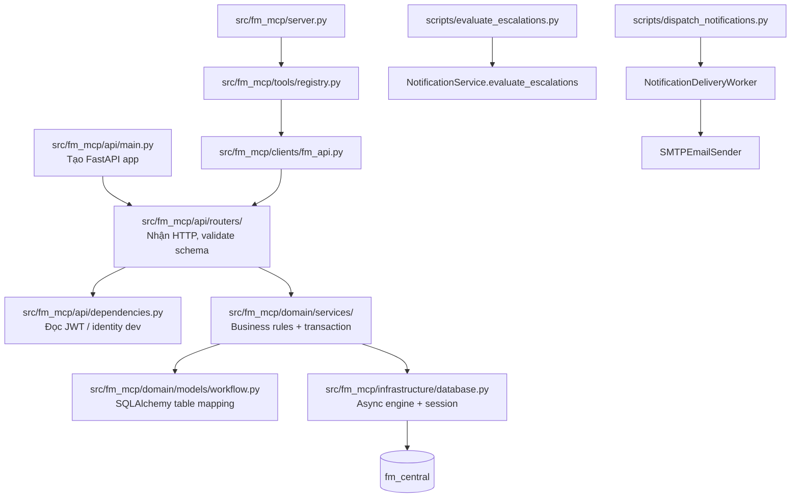
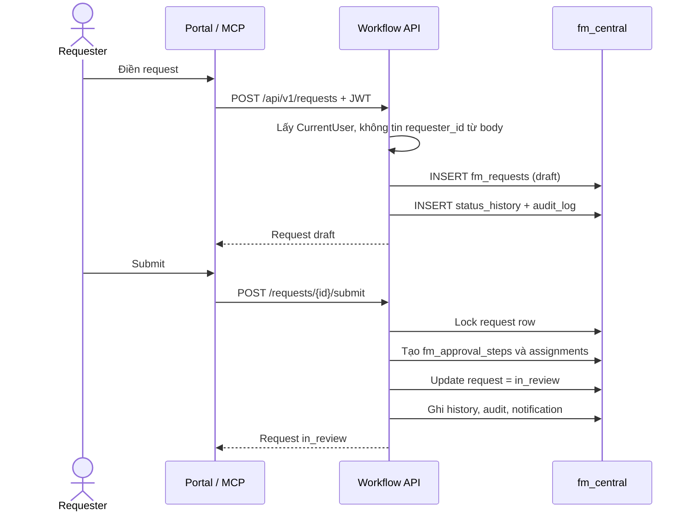
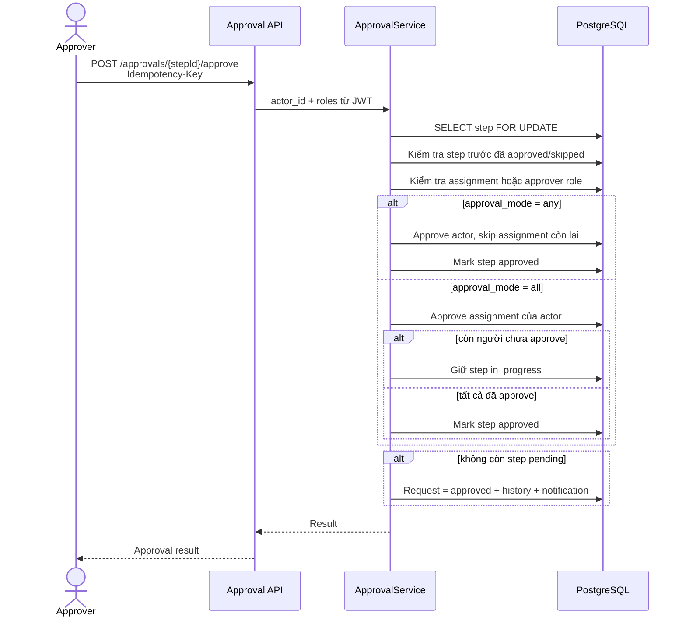
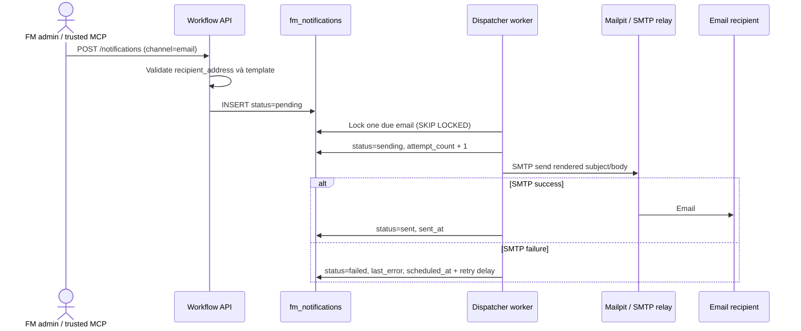

# Hướng dẫn đọc code FM Workflow Automation

Tài liệu này dành cho người mới vào repository. Hãy đọc theo thứ tự: entry
point → router → service → model → worker. MCP không mở database; mọi business
rule nằm ở API service.

## 1. Bản đồ source code

| Nơi đọc | Mục đích | Khi cần sửa |
|---|---|---|
| `api/main.py` | Đăng ký router và tạo app. | Thêm một nhóm endpoint mới. |
| `api/routers/` | HTTP method, URL, Pydantic request/response, quyền truy cập cơ bản. | Thay REST contract. |
| `api/dependencies.py` | Chuyển JWT/header thành `CurrentUser`. | Thay identity provider hoặc RBAC. |
| `domain/services/` | Quy tắc nghiệp vụ và atomic transaction. | Thay workflow, approval, risk, notification. |
| `domain/models/workflow.py` | Tên table, FK, index, constraint, relationship. | Thay database model kèm migration. |
| `schemas/` | Kiểm tra dữ liệu đầu vào và shape response. | Thêm field vào API. |
| `tools/registry.py` | MCP tool mỏng gọi REST. | Expose endpoint an toàn cho MCP. |
| `scripts/` | Worker tin cậy chạy từ scheduler/container. | Tác vụ nền, không phải public API. |

## 2. Luồng tạo và gửi request

## 3. Luồng approval tuần tự và `any` / `all`

`conditions.approver_ids` trên workflow step chứa các user ID đã được Control
Plane/organizational service resolve. Khi danh sách này trống, API kiểm tra role
đã xác thực thay vì nhận `approver_id` từ client.

## 4. Luồng email an toàn và có retry

Worker gửi email **sau** khi transaction queue đã commit. Vì vậy người dùng không
nhận email trùng chỉ vì request HTTP retry; delivery state được nhìn thấy trong
`fm_notifications`.

## 5. Function map

| Module / function | Làm gì | Điều không làm |
|---|---|---|
| `WorkflowService.create_request` | Tạo request draft, status history, audit. | Không nhận requester ID từ client. |
| `WorkflowService.submit` | Khóa request, tạo approval steps/assignments, queue notification. | Không approve request. |
| `WorkflowService.close` | Đóng request đã approved. | Không cho đóng draft/in_review. |
| `ApprovalService.pending` | Lọc step mà current user đủ điều kiện xử lý. | Không expose step không tuần tự. |
| `ApprovalService.act` | Lock step/request, xử lý idempotency và action. | Không cho approve thay người khác. |
| `RiskService.assess` | Lưu likelihood/impact/score và audit. | Không tự thay ownership request. |
| `NotificationService.queue` | Lưu notification outbox record. | Không gọi SMTP trong HTTP request. |
| `NotificationService.evaluate_escalations` | Tạo reminder duy nhất cho step/rule/time quá hạn. | Không có public manual endpoint. |
| `NotificationDeliveryWorker.run_once` | Claim email, gửi SMTP, cập nhật sent/failed. | Không gửi `in_app` record qua SMTP. |
| `SMTPEmailSender.send` | Render MIME message và gọi SMTP relay. | Không ghi password SMTP vào log. |
| `tools.registry._call` | Forward MCP call sang REST API với caller headers dev. | Không mở DB session. |

## 6. Checklist khi thêm chức năng

1. Cần bảng/field mới: sửa model **và** tạo Alembic migration mới của module.
2. Thêm Pydantic Create/Update/Read schema.
3. Đặt business rule ở `domain/services`, trong transaction và audit nếu là write.
4. Thêm router nhỏ chỉ lo HTTP/auth/response.
5. Nếu cần MCP, thêm thin tool vào `tools/registry.py`; không copy business rule.
6. Viết test với PostgreSQL test riêng; không chạy migration development lên production.
